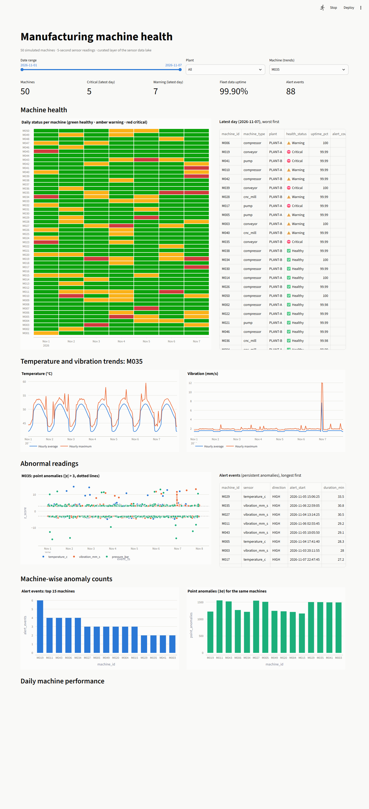
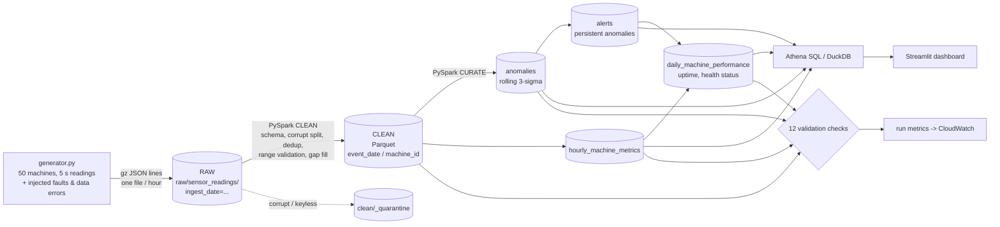

# Manufacturing Sensor Data Lake

> 📄 **Full project report:** [PDF](docs/PROJECT_REPORT.pdf) · [Markdown](docs/PROJECT_REPORT.md)

A batch data lake for machine sensor readings. **6.04 million** simulated temperature,
vibration and pressure readings from **50 machines** flow through **raw -> clean ->
curated** layers with PySpark. The pipeline cleans and validates the data, computes
hourly and daily machine-health metrics, and flags abnormal readings with a **rolling
3-standard-deviation** detector. The results are partitioned Parquet, queryable with
Athena-compatible SQL, and shown in a Streamlit dashboard.

Stack: Python 3.11, PySpark 3.5, Parquet, DuckDB (local stand-in for Athena), Streamlit,
pytest + moto, and AWS S3 / Glue / Athena / CloudWatch (CloudFormation template
prepared, **not deployed**). AI-assisted development (Claude) was used while
building it; every number below comes from an actual run.



## Results (verified, full run from raw)

| What | Result |
|---|---|
| Raw lines ingested (169 hourly gz JSON files) | 6,072,282 |
| Corrupt JSON lines quarantined | 323 |
| Duplicates removed (re-transmissions, across files) | 30,208 |
| Clean readings | **6,041,751**. Reconciliation: raw - corrupt - duplicates = clean exactly |
| Impossible sensor values nulled (e.g. -999) | 1,210 |
| Short gaps forward-filled (<= 15 s) | 61,589 |
| Point anomalies (\|z\| > 3) | 63,743 |
| Alert events (persistent anomalies) | 88 |
| Fault episodes detected (ground truth) | **13 / 13**, median detection delay 0.9 min |
| Single-sample spikes detected | 1,762 / 1,805 (97.6%) |
| Output validation checks | 12 / 12 pass |
| Runtime (local[*], 16 cores) | ~2 min end to end (clean 78 s, anomalies 25 s) |
| Tests | **18 passed**: see `sample_output/test_report.txt` |

## Architecture



On AWS the same code runs as a **Glue 5.0** job (Spark 3.5) with the lake root set to
`s3://<bucket>/sensor-lake`. The Glue Data Catalog plus **Athena** make the curated
tables queryable, and job logs go to **CloudWatch Logs**. Key metrics go to
CloudWatch, where an alarm and an EventBridge rule email on failures. See
[`infra/DEPLOYMENT.md`](infra/DEPLOYMENT.md) and
[`infra/cloudformation.yaml`](infra/cloudformation.yaml) (passes `cfn-lint`).

### Lake layout

```
lake/raw/sensor_readings/ingest_date=YYYY-MM-DD/readings_YYYYMMDDHH.json.gz   (immutable landing)
lake/raw/reference/machines/machines.json
lake/clean/sensor_readings/event_date=.../machine_id=.../*.parquet            (one row per machine+timestamp)
lake/clean/_quarantine/ingest_date=.../                                       (corrupt / keyless rows)
lake/curated/{anomalies,alerts,hourly_machine_metrics,daily_machine_performance}/event_date=.../
lake/curated/dim_machine/   lake/curated/_pipeline_runs/
```

## How the data is cleaned

| Problem injected by the generator | Handling in `clean.py` |
|---|---|
| Truncated JSON lines | explicit schema, PERMISSIVE mode, `_corrupt_record` sent to quarantine |
| Re-transmitted readings (arrive in the *next* hour's file) | `ROW_NUMBER()` over `(machine_id, event_ts)`, latest ingest wins; global, not per file |
| Sentinel values (-999, 9999) | outside the *physical* range: value set NULL and `<sensor>_invalid` flagged |
| Real but abnormal values | outside the *operating* limits: `<sensor>_out_of_spec` flagged, value kept |
| Single-sensor dropouts | forward fill only if the last good value is <= 15 s old (time-based RANGE window); `<sensor>_imputed` flagged |
| Machine offline for 20-90 min | not invented; visible as lower uptime |

## Anomaly detection: how it evolved (measured against ground truth)

The generator saves the faults it injects (`ground_truth/fault_episodes.csv`), so
`python -m sensor_lake.evaluate` measures the detector instead of eyeballing it.

| Version | Anomaly stage | Point anomalies | Alerts | Alert precision | Episode recall |
|---|---|---|---|---|---|
| v1 exact sliding 1-h window | 469 s | 145k | - | - | - |
| v2 pre-aggregated 5-min buckets (same math, O(n)) | 35 s | 199.6k | - | - | 100% |
| v3a + separate on-shift / off-shift baseline | 25 s | 100.8k | 744 | 1.7% | 100% |
| **v3b + real-time window with warm-up, persistence-based alerts** | **25-33 s** | **63.7k** | **88** | **14.8%** | **100%** |

What drove each change:

* v1 to v2: Spark recomputes a sliding RANGE-window aggregate over ~720 rows for
  every reading. Keeping count, sum and sum of squares per 5-minute bucket and rolling
  those is O(n). A test proves the result equals numpy's mean/std.
* v2 to v3a: **71% of false positives were at 06:00 and 22:00 UTC**, the shift
  changes, where load raises temperature by 4 °C in one step.
* v3a to v3b: reaching back to the previous evening's data was still wrong (a
  different phase of the daily cycle). The baseline now uses only the last hour of
  real time, so detection pauses ~10 min after a state change (warm-up).
* Pressure and vibration false positives (~16k each) now match the **theoretical 3σ
  floor**: 0.27% of 6.04M Gaussian readings ≈ 16.3k. This is why the **alert layer**
  (≥ 3 anomalies within 60 s) exists: random noise rarely repeats, real faults do.

## Project layout

```
src/sensor_lake/
  config.py        lake paths (local or s3://), sensor ranges, thresholds
  generator.py     synthetic sensor data + injected faults + ground truth
  spark_session.py SparkSession factory (+ Windows file-system shim)
  schemas.py       explicit raw schema
  clean.py         raw -> clean transformations
  curate.py        anomalies (rolling 3-sigma), alerts, hourly, daily health
  validate.py      12 output validation checks
  monitoring.py    CloudWatch custom metrics (boto3)
  pipeline.py      job orchestration, metrics, CLI
  evaluate.py      detector precision / recall vs ground truth
  local_sql.py     runs athena/queries/*.sql locally with DuckDB
athena/            Athena DDL (partition projection) + 6 analysis queries
dashboard/app.py   Streamlit dashboard
glue/glue_job.py   AWS Glue entry point
infra/             CloudFormation, Glue packaging, deployment guide with costs
windows_compat/    80-line Hadoop FileSystem shim (see below)
tests/             18 tests: unit (Spark), mocked CloudWatch, end-to-end + idempotency
```

## Run it

```bash
pip install -r requirements.txt && pip install -e .     # Java 17 required for Spark
python -m sensor_lake.generator          # ~6M readings into lake/raw (3 min, 96 MB)
python -m sensor_lake.pipeline           # raw -> clean -> curated + validation (~2 min)
python -m sensor_lake.evaluate           # detector quality vs ground truth
python -m sensor_lake.local_sql          # run the Athena queries locally (DuckDB)
streamlit run dashboard/app.py           # http://localhost:8501
pytest -v
```

### Windows note

Hadoop writes local files through `winutils.exe`, an unofficial binary. Instead of
downloading that, `windows_compat/WindowsLocalFileSystem.java` subclasses Hadoop's
`RawLocalFileSystem` and turns POSIX permission calls (meaningless on Windows) into
no-ops. It is compiled with the local JDK on first use and is never used on
Linux or Glue.

## Known limitations

* **Not deployed to AWS.** S3/Glue/Athena/CloudWatch are prepared (CloudFormation,
  Glue script, mocked-AWS test), but no AWS account was available. Athena SQL was
  executed with DuckDB, not Athena.
* Each run reprocesses all raw data (idempotent through dynamic partition overwrite).
  Incremental processing would need a lookback for late duplicates and the previous
  hour as anomaly context.
* Data is synthetic. The model (daily cycle, shift load, Gaussian noise) is simpler
  than real machines, and real faults are rarer and less clean.
* Alert precision is 14.8% (75 false alerts in 350 machine-days, about 1 per machine
  per 5 days). Temperature is noisiest because the daily cycle shifts the mean
  within the 1-hour window; detrending by hour of day would help.
* Warm-up after shift changes delays detection (M019's fault: 9.4 min).
* Baseline contamination: after a fault clears, the baseline still holds fault
  values for up to an hour.
