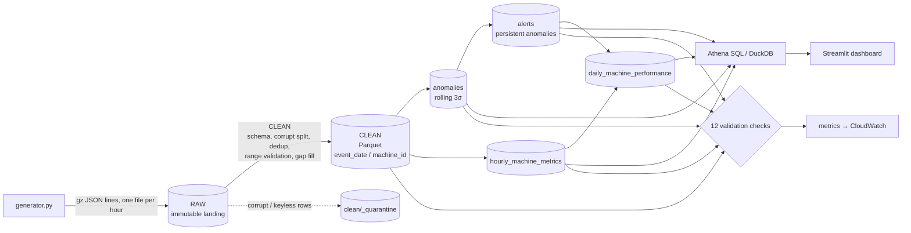
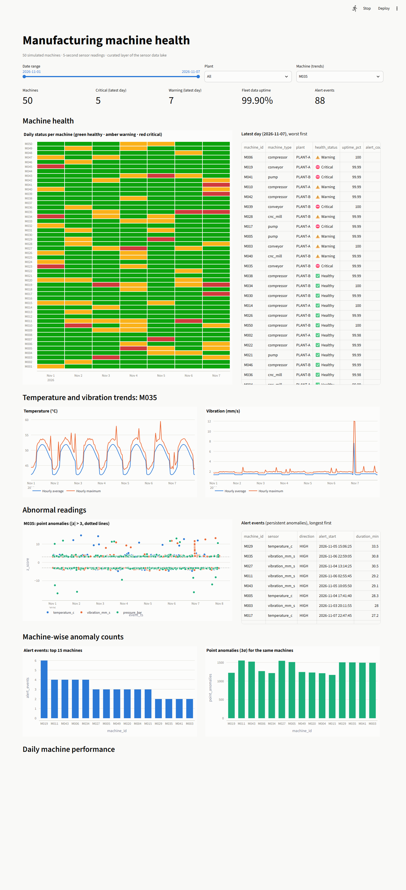

# Project Report: Manufacturing Sensor Data Lake

**Author:** G. Sohan, B.Tech Electronics and Communication Engineering (Class of 2027)  
**Institution:** Amrita Vishwa Vidyapeetham, Bengaluru
**Type:** Individual data engineering portfolio project
**Date:** November 2026
**Stack:** Python 3.11 · PySpark 3.5 · Parquet · DuckDB · Streamlit · pytest + moto ·
AWS S3 / Glue / Athena / CloudWatch (infrastructure prepared, **not deployed**)

---

## Table of contents
1. [Abstract](#1-abstract)
2. [Problem statement and objectives](#2-problem-statement-and-objectives)
3. [Sensor data generation](#3-sensor-data-generation)
4. [Technology choices](#4-technology-choices)
5. [System architecture](#5-system-architecture)
6. [Clean layer: validation and cleaning](#6-clean-layer-validation-and-cleaning)
7. [Curated layer: metrics, anomalies and health](#7-curated-layer-metrics-anomalies-and-health)
8. [Anomaly detection: design, evaluation and iteration](#8-anomaly-detection-design-evaluation-and-iteration)
9. [Storage design: Parquet and partitioning](#9-storage-design-parquet-and-partitioning)
10. [SQL layer (Athena-compatible)](#10-sql-layer-athena-compatible)
11. [Dashboard](#11-dashboard)
12. [AWS deployment design](#12-aws-deployment-design)
13. [Testing and validation](#13-testing-and-validation)
14. [Challenges and solutions](#14-challenges-and-solutions)
15. [Limitations](#15-limitations)
16. [Future work](#16-future-work)
17. [Conclusion](#17-conclusion)
18. [How to reproduce](#18-how-to-reproduce)
19. [References and acknowledgements](#19-references-and-acknowledgements)

---

## 1. Abstract

This project builds a batch data lake for industrial machine sensor data. A Python
generator simulates **50 machines** reporting temperature, vibration and pressure
every 5 seconds for 7 days. That is **6.04 million readings**, with realistic noise,
missing values, duplicates, corrupt records and injected machine faults. A **PySpark**
pipeline moves the data through **raw → clean → curated** layers stored as
partitioned **Parquet**. Along the way it validates readings, removes duplicates,
fills short gaps, computes hourly and daily machine-health metrics, and flags abnormal
readings with a **rolling 3-standard-deviation** detector.

Because the generator records the faults it injects, the detector was **measured
against ground truth**. Final version: **13 of 13 fault episodes detected** (median
0.9 minutes after onset) and **97.6%** of single-sample spikes caught. False alert
events were reduced from 744 to **88** across four design iterations, and the anomaly
stage was made **13× faster** (469 s to 35 s). Results are served through
Athena-compatible SQL (executed locally with DuckDB) and a Streamlit dashboard. AWS
infrastructure (S3, Glue, Athena, CloudWatch, cost budget) is defined in a validated
CloudFormation template but was not deployed. All 18 automated tests pass.

---

## 2. Problem statement and objectives

Plants instrument machines with sensors, but raw telemetry cannot be trusted as-is:
sensors drop out, gateways re-send messages, transmissions get truncated and faulty
sensors report impossible values. Engineers need a pipeline that separates **sensor
faults** (bad data) from **machine faults** (real problems), and presents machine
health in a form people can act on.

| # | Objective | Status |
|---|---|---|
| O1 | Generate realistic sensor data for 50 machines with noise, gaps, duplicates and faults | Achieved |
| O2 | Raw / clean / curated data-lake layers | Achieved |
| O3 | PySpark cleaning: dedup, missing values, range validation | Achieved |
| O4 | Hourly averages and maximums | Achieved |
| O5 | 3-standard-deviation anomaly detection | Achieved and evaluated |
| O6 | Partitioned Parquet storage | Achieved |
| O7 | Local implementation first | Achieved |
| O8 | Deploy to AWS S3 and Glue; query with Athena; CloudWatch monitoring | **Prepared, not deployed** (no AWS account available; Glue is billable) |
| O9 | Streamlit dashboard | Achieved |
| O10 | Automated validation and tests | Achieved (12 output checks, 18 tests) |

---

## 3. Sensor data generation

`src/sensor_lake/generator.py` models each sensor as a signal:

```
value = baseline (per machine type, with per-machine variation)
      + daily cycle (ambient temperature, sinusoid peaking mid-afternoon)
      + shift-load step (machines under load 06:00-22:00 UTC)
      + Gaussian noise
      + injected fault episodes
```

| Machine type | Temperature (°C) | Vibration (mm/s) | Pressure (bar) |
|---|---|---|---|
| pump | 55 | 2.0 | 6.0 |
| compressor | 70 | 3.0 | 8.0 |
| conveyor | 45 | 1.5 | 4.5 |
| cnc_mill | 60 | 2.5 | 5.5 |

**Injected machine faults (ground truth)**

| Fault | Sensor | Pattern | Episodes |
|---|---|---|---|
| Bearing wear | vibration | ramps up 8–12 mm/s over 45 min, holds 15 min | 6 |
| Overheating (cooling failure) | temperature | ramps up 20–30 °C over 30 min, holds 20 min | 4 |
| Hydraulic leak | pressure | sudden drop of 2.5–3.5 bar for 15 min | 3 |
| EMI spike | any | single sample, 8–15 σ | 1,805 |

**Injected data problems**

| Problem | How it appears | Volume |
|---|---|---|
| Sensor dropouts | single sensor value NULL | ~1% of values |
| Machine offline | no rows for 20–90 minutes | 9 machines |
| Re-transmissions | exact duplicate delivered in the **next hour's** file | 30,210 |
| Impossible values | sentinels `-999` / `9999` | ~0.02% |
| Corrupt records | truncated JSON lines | 323 |

**Output:** 169 hourly gzipped JSON-lines files (96 MB) in
`raw/sensor_readings/ingest_date=YYYY-MM-DD/`, 6,072,282 lines, plus a machine
reference file. The ground truth goes to `ground_truth/fault_episodes.csv`, outside
the lake. The generator is seeded and deterministic, and writes each file atomically
(temporary name, then rename).

---

## 4. Technology choices

| Technology | Why | Trade-off |
|---|---|---|
| **PySpark 3.5** | parallel processing on all cores locally; the same code runs on AWS Glue 5.0 (Spark 3.5) across workers | JVM startup overhead; 6M rows would also fit single-node tools such as DuckDB or Polars |
| **Parquet (Snappy)** | columnar, compressed, typed, with min/max statistics; engines read only the columns needed | not human-readable |
| **Hive-style partitioning** | `event_date=` folders let queries skip whole days (partition pruning) | too many partitions create a small-files problem |
| **DuckDB** | runs the Athena SQL locally over the same Parquet files, without an AWS account | SQL dialect differs from Athena (Trino); queries use the common subset |
| **Streamlit + Plotly** | interactive dashboard in pure Python | not a full BI tool |
| **boto3 + moto** | CloudWatch publishing code tested against a mocked AWS | a mock is not the real service |
| **CloudFormation** | infrastructure as code, reviewable and repeatable | not executed against a real account |

---

## 5. System architecture



| Layer | Contents | Format / partitioning |
|---|---|---|
| **Raw** (bronze) | readings exactly as received; never edited | gz JSON lines, `ingest_date` |
| **Clean** (silver) | one row per machine and timestamp, validated, with quality flags | Parquet, `event_date` + `machine_id` (350 partitions, one file each) |
| **Curated** (gold) | anomalies, alerts, hourly metrics, daily performance, machine dimension | Parquet, `event_date` |

The lake root is a single setting, either a local folder or `s3://bucket/sensor-lake`,
so the same code runs locally and on AWS.

---

## 6. Clean layer: validation and cleaning

| Step | Implementation (`clean.py`) | Result |
|---|---|---|
| Parse with an explicit schema | `PERMISSIVE` mode; malformed lines go to `_corrupt_record` | 323 corrupt lines quarantined |
| Key validation | rows without `machine_id` or a parseable timestamp are quarantined | 0 |
| Deduplication | `ROW_NUMBER()` over `(machine_id, event_ts)`, latest ingest wins; works across files | 30,208 removed |
| Physical range check | outside the possible range → value NULL, `<sensor>_invalid = true` | 1,210 values |
| Operating-limit check | outside normal limits → value kept, `<sensor>_out_of_spec = true` | flagged |
| Gap filling | forward fill only if the last good value is ≤ 15 s old (time-based `RANGE` window); `<sensor>_imputed = true` | 61,589 values |

**Two levels of validation.** A temperature of −999 °C is physically impossible, so it
is a *sensor fault* and the value is removed. A temperature of 95 °C is possible but
above the 90 °C operating limit, so it is a *machine problem*: the value is kept and
flagged.

**Row reconciliation (exact):**
6,072,282 raw − 323 corrupt − 0 keyless − 30,208 duplicates = **6,041,751 clean**.
The detector logged 30,208 duplicates against 30,210 injected because in two cases
the corrupted line was itself one of the copies.

---

## 7. Curated layer: metrics, anomalies and health

| Table | Grain | Contents | Rows |
|---|---|---|---|
| `anomalies` | reading × sensor | value, rolling mean/std, z-score, direction, severity | 63,743 |
| `alerts` | alert event | machine, sensor, start/end, duration, anomaly count, peak \|z\| | 88 |
| `hourly_machine_metrics` | machine × hour | avg/min/max/std per sensor, invalid/imputed/out-of-spec counts, anomaly count, completeness % | 8,398 |
| `daily_machine_performance` | machine × day | uptime %, temperature/vibration/pressure summary, alerts, health status | 350 |
| `dim_machine` | machine | type, plant, production line, install year | 50 |

**Daily health status**
* **CRITICAL:** an operating limit was breached, or alerts lasted ≥ 10 minutes in total.
* **WARNING:** any alert, or data uptime below 95%.
* **HEALTHY:** otherwise.

Across the 7 days, 34–41 machines per day were healthy, 7–14 were in warning and 1–5
were critical. Fleet data uptime was 99.90%.

---

## 8. Anomaly detection: design, evaluation and iteration

**Method.** For every reading, compare it with the same machine's recent behaviour:

```
z = (value − rolling_mean) / rolling_std ;   anomaly if |z| > 3
```

The baseline uses only data **before** the reading, so a spike cannot inflate its own
baseline and hide itself. Imputed values are excluded from the baseline.

**Evaluation.** `python -m sensor_lake.evaluate` labels each anomaly as true (inside an
injected episode or spike, same machine and sensor) or false, and reports recall,
detection delay and precision.

### Iterations

| Version | Change | Anomaly stage time | Point anomalies | Alert events | Alert precision | Episode recall |
|---|---|---|---|---|---|---|
| v1 | exact sliding 1-hour `RANGE` window | 469 s | 145k | — | — | — |
| v2 | pre-aggregated 5-minute buckets (same statistics, O(n)) | 35 s | 199.6k | — | — | 100% |
| v3a | baseline separated by operating state (on-shift / off-shift) | 25 s | 100.8k | 744 | 1.7% | 100% |
| **v3b** | **real-time 1-hour window + warm-up; persistence-based alerts** | **22–33 s** | **63.7k** | **88** | **14.8%** | **100%** |

**v1 → v2 (performance).** A sliding `RANGE` window makes Spark recompute average and
standard deviation over ~720 rows for every reading, which costs O(rows × window). The
fix keeps only the *sufficient statistics* per 5-minute bucket (count n, Σx, Σx²),
rolls those over the previous 12 buckets, and derives:

```
mean = Σx / n          std = sqrt( (Σx² − (Σx)²/n) / (n − 1) )
```

The small bucket table (~100k rows instead of 6M) is **broadcast-joined** back to the
readings. A unit test proves the result equals numpy's mean and standard deviation.

**v2 → v3a (precision).** Measuring false positives by hour showed **71% of them at
06:00 and 22:00 UTC**, the shift changes, where load raises temperature by 4 °C in one
step. The baseline is therefore computed separately for on-shift and off-shift periods.

**v3a → v3b.** Using the previous evening's on-shift data at 06:00 was still wrong,
because the daily temperature cycle is at a different phase. The baseline now uses
only same-state data from the **last hour of real time**. Right after a state change
there are fewer than 120 points, so detection pauses for about 10 minutes (warm-up).
**Alerts** were added for operators: at least 3 anomalies within 60 seconds on the
same machine and sensor, grouped into events with the *gaps-and-islands* pattern
(`LAG` + running `SUM`).

### Final results (v3b)

| Metric | Value |
|---|---|
| Fault episodes detected | **13 / 13 (100%)** |
| Median detection delay | **0.9 min** |
| Spikes detected | 1,762 / 1,805 (97.6%) |
| Alert events | 88 (13 true, 75 false), precision 14.8% |
| False alerts per machine | about 1 every 5 days |
| Point-anomaly precision | 7.2% |

**The 3σ noise floor.** For Gaussian noise, 0.27% of normal readings exceed 3σ:
0.27% × 6.04M ≈ 16.3k per sensor. The measured false positives for pressure (16,149)
and vibration (16,154) match this theory almost exactly. That is the reason for the
alert layer: random noise rarely repeats several times in a minute, real faults do.

---

## 9. Storage design: Parquet and partitioning

* **Clean** is partitioned by `event_date` and `machine_id`. Data is repartitioned on
  the same keys before writing, so each partition holds one file (350 files) instead
  of one file per task per partition.
* **Curated** tables are partitioned by `event_date` only; they are small.
* **Dynamic partition overwrite** makes reruns replace only the partitions present in
  the new output, so the pipeline is idempotent.
* Partitioning by hour was rejected: 8,400 folders of ~720 rows each would create a
  small-files problem.

---

## 10. SQL layer (Athena-compatible)

`athena/01_create_tables.sql` defines external tables with **partition projection**, so
new daily partitions are queryable without a crawler or `MSCK REPAIR`.
`athena/queries/` contains 6 analysis queries written in SQL that both Athena (Trino)
and DuckDB accept. **They were executed with DuckDB over the local Parquet, not on
Athena.**

| Query | Result highlight |
|---|---|
| 01 machines with most alerts | M019 most alert events (6); M043, M011, M034, M006 next (4 each) |
| 02 daily uptime | fleet average 99.77–99.99% per day; lowest machine-day 94.02% |
| 03 fleet health by day | 34–41 healthy, 7–14 warning, 1–5 critical per day |
| 04 vibration trend with 3-hour moving average | M035 hourly average jumps to 7.69 mm/s (max 12.0) during bearing wear |
| 05 anomalies by machine type and sensor | ~47–91 point anomalies per machine-day per sensor |
| 06 longest alerts | the top 9 match injected fault episodes (26–34 minutes each) |

Results: `sample_output/athena_results.md`.

---

## 11. Dashboard

`dashboard/app.py` (Streamlit) reads the curated layer through DuckDB views and shows
the five required views: machine health (status heatmap and latest-day table),
temperature and vibration trends, abnormal readings (z-score scatter and alert table),
machine-wise anomaly counts, and daily machine performance. Filters: date range,
plant, machine. Queries are parameterised, and status is shown with both colour and
text labels.



---

## 12. AWS deployment design

**Status: prepared and validated locally, not deployed.**

| Concern | Local | AWS design |
|---|---|---|
| Storage | `./lake/` | S3 bucket (encrypted, public access blocked, versioned, lifecycle: raw → Infrequent Access after 30 days) |
| Compute | PySpark `local[*]` | Glue 5.0 job, 2 × G.1X workers, 30-minute timeout |
| Catalog / SQL | DuckDB views | Glue Data Catalog + crawler, Athena workgroup with a 1 GB-per-query scan limit |
| Logs | stdout | CloudWatch Logs (automatic for Glue) |
| Metrics / alerts | logged | 6 custom CloudWatch metrics; alarm on `ValidationFailures > 0`; EventBridge rule on job failure → SNS email |
| Cost control | — | AWS Budget of $5/month with alerts at 80% actual and 100% forecast |

**Verification performed without an AWS account:**
* `cfn-lint` on `infra/cloudformation.yaml`: no findings.
* CloudWatch publishing tested against a mocked AWS (moto), including batching above 20 metrics.
* Glue package build (`infra/package_for_glue.py`): 9 modules, 15 KB.

**Estimated cost** (list prices, to be re-checked before deploying): about $0.08 per
Glue run, under $0.01 per month for S3 and Athena at this volume, and $0 for metrics
(within the 10-metric free tier). Steps: `infra/DEPLOYMENT.md`.

---

## 13. Testing and validation

### Output validation (runs after every pipeline run): 12 / 12 pass

| Check | Purpose |
|---|---|
| no duplicate `(machine_id, event_ts)` in clean | dedup worked |
| clean row reconciliation | raw − corrupt − keyless − duplicates = clean |
| values within physical ranges | invalid values removed |
| no null keys | — |
| hourly count ≤ 720 | no double counting |
| hourly totals = clean rows | aggregation complete |
| every anomaly has \|z\| > 3 | detector rule respected |
| anomalies only for known sensors | — |
| every alert has ≥ 3 anomalies | persistence rule respected |
| alert end ≥ start | — |
| valid health statuses | — |
| uptime between 0 and 100 | — |

If any check fails, the job exits non-zero (on AWS this triggers the CloudWatch alarm).

### Automated tests: 18 / 18 pass (`sample_output/test_report.txt`)

| Suite | Count | Covers |
|---|---|---|
| `test_clean.py` | 6 | corrupt-line split, timestamp quarantine, dedup (latest wins), range validation, gap-fill age limit, output schema |
| `test_curate.py` | 7 | spike detection, warm-up, **bucketed baseline equals numpy**, alert persistence and grouping, hourly metrics, health rules |
| `test_generator_and_monitoring.py` | 4 | injected problems, determinism, atomic writes, CloudWatch publishing (mocked) |
| `test_end_to_end.py` | 1 | generate → full pipeline → validation and reconciliation; rerun produces identical counts |

---

## 14. Challenges and solutions

| Challenge | Solution |
|---|---|
| **Spark could not write files on Windows** (Hadoop needs `winutils.exe`, an unofficial binary) | wrote an 80-line Java subclass of Hadoop's `RawLocalFileSystem` that turns POSIX permission calls into no-ops; compiled with the local JDK; loaded via `spark.driver.extraClassPath` (loading it with `spark.jars` failed, because jars are resolved through the file system being replaced). Not used on Linux or Glue |
| Anomaly stage took 469 s | bucketed sufficient statistics + broadcast join: 35 s |
| Precision 2.4% | measured false positives by hour; shift-aware baseline; real-time window with warm-up; persistence-based alerts |
| z-scores rounded to 2 decimals made 3.004 look like 3.00 and broke the "\|z\| > 3" rule | caught by validation; full precision stored |
| Alert grouping produced events with fewer than 3 anomalies | caught by validation; grouped first, then filtered by burst size |
| Alert direction was arbitrary (`first()`), and recovery after a fault looked "LOW" | direction taken at the peak deviation (`max_by`) |
| A pipeline run overlapped a generator run and read half-written files (5.8M rows instead of 6.07M; recall fell to 84.6%) | detected by the row counts; generator now writes atomically (temporary file + rename) |
| JVM out-of-memory at start-up when the laptop was short of RAM | driver memory configurable (`SENSOR_LAKE_DRIVER_MEMORY`) |

---

## 15. Limitations

* **Not deployed to AWS.** S3, Glue, Athena and CloudWatch are designed and partly
  verified locally (lint, mocks, DuckDB), not run in a real account.
* **Synthetic data.** Real machines have richer dynamics, and real faults are rarer
  and less clean.
* **Full reprocessing.** Every run recomputes all days. Incremental processing would
  need a lookback for late duplicates and the previous hour as anomaly context.
* **Alert precision 14.8%.** Temperature dominates the false alerts because the daily
  cycle shifts the mean within the 1-hour window.
* **Warm-up blind spot.** Detection pauses ~10 minutes after each shift change (one
  fault's first detection was delayed to 9.4 minutes).
* **Baseline contamination.** After a fault clears, the baseline still contains fault
  values for up to an hour.

---

## 16. Future work

1. Deploy to AWS with the prepared template and record real runtime and cost.
2. Seasonal (hour-of-day) baseline to remove the daily-cycle false positives.
3. Robust statistics (median / MAD) to reduce baseline contamination.
4. Multivariate rules (for example temperature and vibration rising together).
5. Streaming ingestion (AWS IoT Core / Kinesis) with Spark Structured Streaming for
   near-real-time alerts, keeping this batch lake for history.
6. Point the dashboard at Athena instead of local DuckDB.

---

## 17. Conclusion

The project delivers a working raw → clean → curated data lake that turns 6 million
noisy, imperfect sensor readings into validated machine-health information, with
every row accounted for. Measuring the anomaly detector against known faults turned
"it seems to work" into numbers (13/13 faults found, false alerts reduced from 744 to
88), and showed that a textbook 3σ rule needs operating context and persistence to be
useful on real-world signals. The same measurement discipline (row-count
reconciliation, automated output validation and reviewing query results) also
exposed four bugs in the pipeline itself, each of which was fixed.

---

## 18. How to reproduce

```bash
pip install -r requirements.txt && pip install -e .     # Java 17 required for Spark
python -m sensor_lake.generator      # ~3 min, 6M readings into lake/raw
python -m sensor_lake.pipeline       # ~2 min, raw -> clean -> curated + validation
python -m sensor_lake.evaluate       # detector quality vs ground truth
python -m sensor_lake.local_sql      # Athena queries locally with DuckDB
streamlit run dashboard/app.py       # http://localhost:8501
pytest -v
```

---

## 19. References and acknowledgements

* Apache Spark 3.5 documentation: window functions, partitioning, Parquet.
* AWS documentation: Glue 5.0, Athena partition projection, CloudWatch custom metrics, AWS Budgets.
* Montgomery, *Introduction to Statistical Quality Control* (3-sigma control limits).
* AI-assisted development: an AI coding assistant (Claude) was used during
  implementation. All results in this report come from executing the code.
